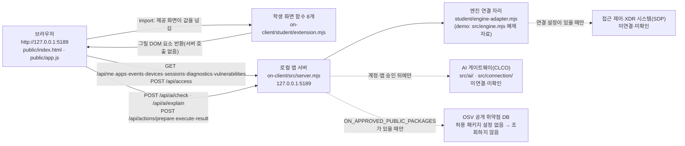

# HTH 보안 Agent 학생 실행 설명서와 시스템 구성도

이 문서는 학생이 직접 작성한 13~20단계의 실행 설명서입니다. 제공된 시작 틀 문서(`README.md`, `docs/STUDENT_LAUNCH_GUIDE.md` 등)는 바꾸지 않았고, 이 문서는 그 문서를 보완합니다. 명령과 화면 문구는 이 저장소의 실제 파일에서 확인한 값만 적었습니다. 확인하지 못한 항목은 「미확인」으로 표시했습니다.

## 1. 목적과 기능

HTH는 회사 직원이 자기 로그인 상태, 업무 앱 접속 결과, 최근 접속 기록과 보안 경보를 보는 보안 앱입니다. 제공된 시작 틀이 서버와 기본 화면을 맡고, 학생이 `on-client/student/extension.mjs`에 화면 표시 함수를 구현합니다.

| 단계 | 학생이 구현한 화면 | 함수 |
|---|---|---|
| 13 | 로그인 사용자·기기·세션 | `renderIdentity` |
| 14 | 업무 앱 접근 요청 결과 | `renderDecision` |
| 15 | 접속 기록·XDR 경보 목록과 상세 | `renderEvents` |
| 16 | 기기·세션·알림·진단 정보, 미지원 조치 안내 | `renderStatus` |
| 17 | 앱 내부 AI 연결 점검 결과 | `renderAiConnection` |
| 18 | 근거에 연결된 AI 사건 설명 | `renderExplanation` |
| 19 | 보안 조치 요청 상태와 실제 결과 구분 | `renderAction` |
| 20 | 설치 패키지 버전과 알려진 취약점 조회 결과 | `renderVulnerabilities` |

## 2. 필요 프로그램과 버전

| 항목 | 이 PC에서 확인한 값 | 시작 틀 기준·허용 범위 |
|---|---|---|
| Windows | Windows 11 Pro | 실행 도구가 PowerShell(`.ps1`)이므로 Windows 기준입니다. macOS·Linux는 미확인입니다. |
| Node.js | v24.21.0 | `on-client/package.json`의 engines는 24.19.0이고, 실행 도구는 22~24를 허용합니다. 24.19.0에서 실행한 적은 없습니다(미확인). |
| npm | 11.19.0 | 외부 npm 의존성은 없습니다(`on-client/package.json`에 dependencies가 없음). |
| Git | 2.55.0 | 커밋과 제출 준비에 씁니다. |
| 브라우저 | PC 브라우저 | 화면 점검은 Chrome으로 했습니다. 다른 브라우저는 미확인입니다. |

Node.js가 v24.19.0이 아니면 실행 도구가 「참고: 지금 Node.js 는 vXX 입니다. 수업 기준은 v24.19.0 입니다.」라고 알리고 계속 실행합니다. 22 미만이거나 25 이상이면 실행을 멈춥니다(`on-client/tools/start-alekov.ps1`의 버전 검사).

## 3. 폴더 구조

Git 저장소의 최상위는 `on-client`가 아니라 그 위의 프로젝트 폴더입니다. 앱 폴더는 `on-client`입니다.

```text
프로젝트 폴더/                  Git 최상위 (커밋·제출은 여기서)
├─ README.md                    프로젝트 전체 설명(학생 작성) + 13~20단계 문서 안내
├─ on-client/                   앱 폴더 (ALEKOV 시작 틀 0.2.11 + 학생 구현)
│  ├─ package.json              스크립트: start, demo, check
│  ├─ .env.example              설정 견본(변수 이름만 있고 비밀 값 없음)
│  ├─ src/server.mjs            로컬 앱 서버 (제공, 수정하지 않음)
│  ├─ src/engine.mjs           예제(demo) 모드 자료 (제공)
│  ├─ src/ai/, src/actions/, src/connection/, src/vulnerabilities/   AI·조치·계정 연결·패키지 조회 (제공)
│  ├─ public/index.html, app.js, style.css, ai-connect.mjs, vulnerabilities-view.mjs   브라우저 화면 (제공)
│  ├─ student/extension.mjs     학생이 구현한 화면 표시 함수 8개 (학생 작성)
│  ├─ student/engine-adapter.mjs  기존 서버·에이전트 연결 자리 (제공, 이 프로젝트에서는 수정하지 않음)
│  ├─ tools/start-alekov.ps1    실행 도구 (제공)
│  └─ docs/                     제공 문서 + 이 문서(STUDENT_RUNBOOK.md)
├─ src/, api/, public/, scripts/, test/, xdr/, ops/   1~12단계와 보너스 작업 (이 문서의 범위 밖, 변경하지 않음)
└─ .gitignore                   .env, .env.*, node_modules/ 등을 제외
```

## 4. 실행·접속·종료·재실행

### 4.1 PowerShell을 여는 위치

파일 탐색기에서 `on-client` 폴더를 열고 주소 표시줄에 `powershell`을 입력한 뒤 Enter를 누릅니다. 이 폴더가 앱 폴더입니다.

이미 열려 있는 PowerShell이나 VS Code 터미널은 보통 프로젝트 폴더(Git 최상위)에서 열립니다. 이때는 먼저 아래 명령으로 앱 폴더로 이동한 뒤 4.2의 명령을 실행합니다. 프롬프트가 `...\on-client>`로 끝나면 앱 폴더입니다.

```powershell
cd on-client
```

### 4.2 실행 명령

| 목적 | 명령(앱 폴더에서) | 설명 |
|---|---|---|
| 권장 실행 | `powershell -NoProfile -ExecutionPolicy Bypass -File .\tools\start-alekov.ps1` | Node.js 버전·폴더·포트를 먼저 확인합니다. `-ExecutionPolicy Bypass`는 이번 실행에만 적용됩니다. |
| 같은 서버를 직접 실행 | `npm start` | 실행 도구의 사전 검사가 없습니다. |
| 예제 자료로 화면 보기 | `npm run demo` | 예제 자료입니다. 실제 연결이나 성취가 아닙니다. |
| 학생 파일 문법 검사 | `npm run check` | `student/extension.mjs`의 문법만 확인합니다. 화면 동작은 확인하지 않습니다. |
| 다른 포트로 실행 | `powershell -NoProfile -ExecutionPolicy Bypass -File .\tools\start-alekov.ps1 -Port 5190` | 5189를 다른 프로그램이 쓸 때 씁니다. |

### 4.3 브라우저 주소와 정상 시작 신호

- 주소: `http://127.0.0.1:5189/` (포트를 바꾸면 그 번호). 서버는 `127.0.0.1`에만 연결되어 같은 PC 안에서만 열립니다.
- 실행 도구가 서버가 뜬 뒤 출력하는 두 줄(`tools/start-alekov.ps1` 133~134행 원문):
  - `케셰브가 켜졌습니다. 브라우저에서 <주소> 을 여세요.`
  - `서버가 응답한 것만 확인했습니다. AI 연결 상태는 화면에서 따로 확인해 주세요.`
- 이 PC에서 실제로 출력된 내용(앱 폴더에서 4.2의 권장 명령을 실행한 결과):

```text
참고: 지금 Node.js 는 v24.21.0 입니다. 수업 기준은 v24.19.0 입니다.
케셰브 연결 확인: http://127.0.0.1:5189
케셰브가 켜졌습니다. 브라우저에서 http://127.0.0.1:5189/ 을 여세요.
서버가 응답한 것만 확인했습니다. AI 연결 상태는 화면에서 따로 확인해 주세요.
끄려면 이 창에서 Ctrl+C 를 누르세요.
```

  첫 줄은 Node.js가 v24.19.0이 아닐 때만 나옵니다. 「케셰브 연결 확인」 줄은 서버(`src/server.mjs`)가 출력하며, `npm run demo`로 켜면 「케셰브 예제」로 나옵니다. 5190 포트로 실행했을 때는 서버가 `GET /`에 HTTP 200으로 응답하는 것도 확인했습니다.
- 화면: 위쪽 상태 표시와 「보호 현황」 화면이 보이면 서버가 응답한 것입니다. 이것만으로 AI·계정 연결 성공을 뜻하지 않습니다.
- 기본 실행(`start-alekov.ps1`, `npm start`)의 화면: 오른쪽 위에 「연결 없음」 배지가 보이고, 위쪽 빨간 안내에 「기존 서버·에이전트의 연결을 확인할 수 없습니다. 연결 어댑터를 먼저 확인하세요.」가 항목별(로그인 정보, 업무 앱, 보안 기록, 기기, 세션)로 나옵니다. 「현재 로그인」 칸은 「확인 불가 (요청 실패)」, 학생 칸은 「연결 실패: …」로 표시됩니다. 서버를 연결하지 않았으므로 정상 상태이며, 사용자가 이 화면을 이 PC에서 확인했습니다. 예제 자료로 같은 화면을 채워 보려면 `npm run demo`를 씁니다.

### 4.4 종료와 재실행

1. 종료: 서버를 실행한 PowerShell 창에서 `Ctrl+C`를 누릅니다. 브라우저에서 주소가 더 이상 열리지 않으면 종료된 것입니다. `-Background`로 실행했다면 화면에 안내된 프로세스 번호의 `node`를 작업 관리자에서 종료합니다.
2. 재실행: 같은 앱 폴더에서 4.2의 명령을 다시 실행합니다. 코드를 고친 뒤에는 서버를 껐다 켜고, 브라우저에서 `Ctrl+F5`로 새로고침합니다.
3. 서버가 꺼진 상태에서 화면 안의 「다시 불러오기」를 누르면 실패 안내가 나옵니다. 같은 상태에서 브라우저의 F5를 누르면 페이지 자체가 열리지 않아 `ERR_CONNECTION_REFUSED`가 나옵니다.

## 5. 시스템 구성도

### 5.1 Mermaid



### 5.2 ASCII

```text
[브라우저 http://127.0.0.1:5189]
   |  public/index.html, public/app.js (제공)
   |      \--> student/extension.mjs (학생): 제공 화면이 값을 넘기고 반환된 DOM을 칸에 끼움
   v  GET/POST /api/...
[로컬 앱 서버 on-client/src/server.mjs  127.0.0.1:5189]
   |--> [엔진 연결 자리 student/engine-adapter.mjs]  --(연결 설정이 있을 때)-->  [접근 제어·XDR 시스템(SDP)]  미확인
   |--> [AI 게이트웨이(CLCO) src/ai/ src/connection/]  --(계정·앱 승인 뒤)-->  AI 모델 목록·사건 설명  미확인
   |--> [OSV 공개 취약점 DB]  --(허용 패키지가 있을 때)-->  패키지 조회  이 프로젝트는 설정 없음
```

### 5.3 구성 요소 표

| 구성 요소 | 실제 파일·주소 | 역할 | 이 프로젝트에서의 상태 |
|---|---|---|---|
| 브라우저 화면 | `on-client/public/index.html`, `app.js` | 「보호 현황」「업무 앱」「보안 기록」 화면, 버튼, 요청 | 제공. 확인함(데모) |
| 학생 화면 함수 | `on-client/student/extension.mjs` | 제공 화면이 넘긴 값을 DOM으로 그림. 서버를 직접 호출하지 않음 | 학생 작성. 13~20단계 구현 |
| 로컬 앱 서버 | `on-client/src/server.mjs` | 브라우저 요청을 받아 엔진·AI·조치·패키지 조회로 나눔 | 제공. 응답 확인함 |
| 엔진 연결 자리 | `on-client/student/engine-adapter.mjs` | 기존 서버·에이전트를 연결하는 자리. 기본값은 연결 없음(`disconnected`) | 연결하지 않음 |
| 접근 제어·XDR 시스템 | 담당자가 준비한 SDP 설정 | 사용자·기기·세션·판정·기록의 실제 원천 | 미확인(연결하지 않음) |
| AI 게이트웨이(CLCO) | `on-client/src/ai/`, `src/connection/` | 모델 점검과 사건 설명 요청 중계 | 미확인(운영 측 권한 준비 필요) |
| OSV 조회 | `on-client/src/vulnerabilities/` | 설치된 정확한 버전을 공개 취약점 DB와 대조 | 허용 패키지 설정이 없어 `not_configured` |

## 6. 구현한 함수·제공 코드 경계

`on-client/student/extension.mjs`가 학생이 수정한 유일한 파일입니다(`createStudentView`가 8개 함수를 반환). 아래는 제공 코드와 학생 코드의 경계입니다.

| 구분 | 제공 코드(수정하지 않음) | 학생 코드(`student/extension.mjs`) |
|---|---|---|
| 요청과 상태 | 서버 요청, 제한 시간, 세대 번호, 취소, 응답 형식 검사, 상태 보관 | 없음. 서버를 호출하지 않고 넘겨받은 값만 사용 |
| 화면 호출 | `studentData(kind)`로 값을 만들어 `student` 함수를 호출하고 반환값을 칸에 끼움 | 값에 따라 DOM 요소를 만들어 반환(`createElement`와 `textContent`만 사용) |
| 버튼 | 「다시 불러오기」, 「도움정보 불러오기」, 「AI 연결 점검」, 「설치 패키지 조회」, 「패키지 조회 취소」, 「대상과 조치를 확인했으며 집행합니다」 등 | 「도움정보 복사」 버튼과 「<action> 미지원」 비활성 버튼만 있음(조치 실행 버튼 없음) |
| 인증·비밀 | 계정 연결, AI 앱 승인, 열쇠 보관 | 비밀값을 받지 않고 쓰지 않음 |

| 함수 | 받는 값 | 상태별 표시의 핵심 |
|---|---|---|
| `renderIdentity` | `{ me, devices, sessions }` | 불러오는 중, 오류, 확인 불가, 주의 상태를 글자로 구분 |
| `renderDecision` | `{ status, mode, data, error, appId }` | 허용·거부·추가 확인·확인 불가, 요청 실패는 거부와 구분 |
| `renderEvents` | `{ status, mode, data, error }` | 최신순 목록, 필터 3개, 상세 토글, 빈 목록과 조회 실패 구분 |
| `renderStatus` | `{ devices, sessions, notifications, diagnostics, mode }` | 불러오는 중·빈 목록·실패·시간 초과 구분, 알림, 진단 6개 값과 「도움정보 복사」 |
| `renderAiConnection` | `{ status, mode, data, error, checkedAt, explanationAccepted }` | 연결 점검과 사건 설명 구분, 오류 원인 분류, 수동 재점검 안내 |
| `renderExplanation` | `{ event, explanation, checkedAt }` | 근거 ID 대조, 확인 불가 상태, 쓸 수 없는 설명 거부, 제안 미실행 |
| `renderAction` | `{ status, event, actionId, target, receipt, observation, ... }` | 제안·준비·전달·접수(ACK)·효과 확인 구분, 효과 관측이 없으면 결과 불명 |
| `renderVulnerabilities` | `{ status, mode, data, error }` | 전체 조회 상태 5종, 패키지 행의 정확한 버전, 일부 조회 실패에서도 받은 ID 유지 |

## 7. 확인한 기능과 확인하지 못한 기능

「공식 판정」은 사용자가 전달한 ALEPH 판정 결과이며, 이 문서의 작성자(AI)가 만든 결과가 아닙니다.

| 기능 | 확인 방법과 결과 |
|---|---|
| 13~20단계 화면 표시 함수 | 모의 데이터를 헤드리스 Chrome에서 점검했고, 예제(demo) 서버의 실제 화면을 사용자가 확인했습니다. 13~20단계는 사용자가 전달한 ALEPH 공식 판정에서 통과했습니다. |
| 자동 재요청 없음 | 화면을 그대로 둔 동안 `/api` 요청이 늘지 않음을 헤드리스 Chrome으로 확인했습니다(16, 20단계). |
| 서버를 끈 뒤 실패 표시와 회복 | 사용자가 16단계에서 서버를 끄고 「다시 불러오기」를 눌러 실패 문구를 확인했고, 서버를 다시 켠 뒤 문구가 사라지는 것도 확인했습니다. |
| 21단계 이 문서 | 아직 제출하지 않았습니다. 판정 결과가 없습니다. |
| 22단계 | 아직 진행하지 않았습니다. |

| 확인하지 못한 기능 | 이유 |
|---|---|
| 실제 계정 연결(native)·SDP 연결 | 담당자가 준비하는 설정 파일이 없습니다. |
| AI 연결 점검 성공(`test`·`verified`), 모델 수 표시 | 운영 측 앱 권한이 준비되지 않아 `ON_AI_PROVISIONING_PENDING`만 확인했습니다. |
| 실제 AI 사건 설명 성공 화면 | 위와 같습니다. 모의 데이터로만 점검했습니다. |
| 실제 조치 준비·집행·결과 재조회 | 현재 기록의 `supportedActions`가 비어 있어 조치 준비 버튼이 나오지 않습니다. 실제 집행은 시험하지 않았습니다. |
| 실제 패키지 행이 나오는 조회 화면 | 이 프로젝트에 허용 패키지 설정(`ON_APPROVED_PUBLIC_PACKAGES`)과 `on-client/package-lock.json`이 없어 `not_configured`만 확인했습니다. |
| 실제 시간 초과 화면 | 모의 데이터로만 점검했습니다. |
| Node.js 24.19.0, macOS, Linux, Chrome 외 브라우저 | 실행해 보지 않았습니다. |

## 8. 오류별 확인 순서

아래 오류는 이 프로젝트에서 실제로 나오는 문구를 기준으로 적었습니다. 더 많은 오류 코드는 `on-client/docs/CONNECTION_TROUBLESHOOT.md`에 있습니다.

| 증상 | 확인 순서 | 근거 |
|---|---|---|
| 「포트 5189 를 다른 프로그램이 쓰고 있습니다」 | 1) 이미 켜 둔 서버 창이 있는지 봅니다. 2) 그 프로그램은 종료하지 말고 `-Port 5190`으로 실행합니다. 이 PC에서 5189 사용 중일 때 종료 코드 1로 멈추는 것을 확인했습니다. | `tools/start-alekov.ps1` |
| 「지금 Node.js 는 vXX 입니다」(멈춤) | Node.js 22~24를 설치하고 PowerShell을 새로 엽니다. | `tools/start-alekov.ps1` |
| PowerShell이 「-File 매개 변수에 대한 인수 '.\tools\start-alekov.ps1'이(가) 없습니다」라고 출력함 | 실행 도구 파일이 현재 폴더에 없는 것입니다. 프로젝트 폴더에서 실행했을 때 실제로 이 문구가 나왔습니다. 프롬프트가 `...\on-client>`인지 확인하고, 아니면 `cd on-client`로 이동한 뒤 다시 실행합니다. | 사용자 PC에서 확인한 출력 |
| 「앱 폴더가 아닙니다」 | `on-client` 폴더에서 실행했는지 확인합니다. | `tools/start-alekov.ps1` |
| 「…초 안에 뜨지 않았습니다」 | 창의 메시지 전체를 담당 강사에게 보여 줍니다. | `tools/start-alekov.ps1` |
| 브라우저에 `ERR_CONNECTION_REFUSED` | 서버가 꺼진 상태입니다. 실행 명령을 다시 실행합니다. | 서버 종료 후 확인 |
| 학생 칸에 「학생 구현 대기」가 남음 | 1) `npm run check`로 문법을 확인합니다. 2) 서버를 껐다 켭니다. 3) 브라우저에서 `Ctrl+F5`를 누릅니다. 20단계에서 이 순서를 안내했고, 새로고침 뒤 학생 칸이 새 표시로 바뀌는 것을 사용자가 확인했습니다. | `public/app.js`의 학생 모듈 불러오기 |
| 화면에 「학생 구현 renderXxx 실행 중 오류가 발생했습니다」 | `student/extension.mjs`에서 해당 함수의 오류입니다. 제공 화면은 계속 동작합니다. | `public/app.js`의 `renderStudent` |
| `ENGINE_NOT_CONNECTED` | 기본 실행(`npm start`)은 기존 서버에 연결하지 않은 상태입니다. 이 PC에서 `/api/me` 응답이 이 코드(`mode: disconnected`)인 것을 확인했습니다. 예제 화면은 `npm run demo`로 봅니다. | 서버 응답 |
| `ON_AI_PROVISIONING_PENDING` (권한 준비 중) | 학생 잘못이 아닙니다. 운영 측 계정·앱 권한 준비가 필요하므로 담당자에게 확인을 요청합니다. 열쇠를 복사하지 않습니다. | AI 연결 점검 화면 |
| 패키지 조회가 `not_configured` | 프로젝트와 허용 패키지 설정은 운영자가 준비합니다. 학생이 임의로 설정을 바꾸지 않습니다. | 패키지 조회 화면 |

## 9. 비밀값과 설정

- 설정 견본은 `on-client/.env.example`입니다. 변수 이름은 `ON_PORT`, `ON_ENGINE_ADAPTER`, `ON_AI_MODEL`, `ON_PROJECT_DIRECTORY`, `ON_APPROVED_PUBLIC_PACKAGES`이며 이 문서에는 값을 적지 않습니다.
- 실제 설정 파일 `.env`와 `.env.*`는 루트 `.gitignore`에 의해 Git에서 제외됩니다. 비밀번호, 토큰, API 키, 개인키는 코드, 문서, 커밋, 캡처에 넣지 않습니다.
- 주소나 열쇠를 직접 입력하는 칸은 만들지 않았습니다.

## 10. 이 문서를 확인하는 방법

1. 새 PowerShell 창을 열고 4.1의 위치에서 4.2의 명령을 그대로 실행합니다.
2. 4.3의 주소를 열어 「보호 현황」 화면이 보이는지 확인합니다.
3. 6장의 함수 이름과 버튼 이름이 `on-client/student/extension.mjs`, `on-client/public/index.html`과 일치하는지 대조합니다.
4. 맞지 않거나 확인하지 못한 항목은 7장의 표에 「미확인」으로 옮깁니다.
